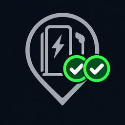
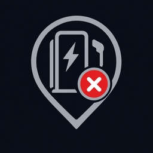

<p align="center"></p>

# EnBW Laadpalen

[](https://github.com/GruttePier013/EnBW-charging-stations/releases)
[](LICENSE)
[](https://analytics.home-assistant.io/custom_integrations.json)

Home Assistant-integratie die laat zien **welke EnBW-laadpunten nu vrij zijn**. Zoek laadpalen in een zone op de kaart, voeg ze toe als eigen apparaat en laat Home Assistant ze automatisch verversen wanneer jij in de buurt komt.

- Aantal vrije laadpunten per laadpaal, plus de status per laadpunt, vermogen, connectoren en openingstijden
- Markers op de HA-kaart die in één oogopslag tonen of er plek is
- Slim verversen: alleen als iemand in de buurt is, zodat de API niet onnodig wordt aangeroepen
- Gebeurtenis zodra een handmatige verversing laat zien dat een laadpunt vrij is geworden

## Installeren
[](https://my.home-assistant.io/redirect/hacs_repository/?owner=GruttePier013&repository=EnBW-chargestations&category=integration)

1. HACS → menu → *Aangepaste repositories* → voeg `https://github.com/GruttePier013/EnBW-chargestations` toe (type *Integratie*).
2. Download **EnBW Laadpalen** en herstart Home Assistant.
3. Instellingen → Apparaten & services → Integratie toevoegen → **EnBW Laadpalen**.

Handmatig: kopieer `custom_components/enbw_charging_stations` naar `config/custom_components/`.

## Laadpalen toevoegen
1. **API-sleutel** (eenmalig, geldt voor alle laadpalen). EnBW biedt geen publieke registratie; gebruik de sleutel die de EnBW-laadstationkaart in de browser meestuurt (header `Ocp-Apim-Subscription-Key`). Wordt de sleutel geweigerd, dan vraagt Home Assistant automatisch om opnieuw te verifiëren.
2. **Standaardwaarden** voor nieuwe laadpalen: vernieuwingsfrequentie, zone radius, vernieuwen in zone en de bijbehorende frequentie en maximale duur. Je kunt ze later aanpassen onder *Configureren → Instellingen*.
3. **Zoeken op de kaart:** typ een plaatsnaam of adres en druk op Enter, dan springt de pin erheen. Verplaats de pin en stel de zoekradius in (50–5000 m). Of kies *Stationsnummer invoeren*.
4. **Resultaten:** vink de gewenste laadpalen aan. Elke laadpaal wordt een eigen apparaat. Per laadpaal zie je twee regels:
   ```
   Hoofdlaan 1, Amsterdam
   2/10 beschikbaar, ⚡17kW vermogen, 📍2925161, 140m van huis
   ```
   (vrije/totaal laadpunten, hoogste vermogen, locatiecode en afstand vanaf je thuislocatie)
5. **Per laadpaal:** naam, optioneel de **connectortypen** en het **minimale vermogen** dat meetelt.

Later beheer je alles via *Configureren*: laadpalen toevoegen, bewerken of verwijderen (ook via *Apparaat verwijderen*), personen kiezen, standaardwaarden, foutbeveiliging en de API-sleutel. Bij *Laadpaal bewerken* kun je de **pin van de laadpaal op de kaart verschuiven**; *EnBW-positie herstellen* zet hem terug.

## Laadpalen op de kaart
Elke laadpaal krijgt een sensor met de naam van straat en huisnummer en als status bijvoorbeeld `2/10 available`. De sensor heeft `latitude` en `longitude` en toont een marker die meeverandert met de beschikbaarheid:

| Marker | Betekenis |
|:---:|---|
|  | 2 of meer laadpunten vrij |
|  | 1 laadpunt vrij |
|  | niets vrij of gesloten |
|  | onbekend, geen gegevens of ouder dan 1 dag |

De markers zijn uit te zetten onder *Configureren → Instellingen* (dan krijg je het gewone icoon).

## Entiteiten per laadpaal
Alle entiteiten krijgen een id die begint met `enbw_chargepoint_<laadpaal>_`, zodat je ze in Home Assistant snel terugvindt, bijvoorbeeld `sensor.enbw_chargepoint_voorbeeldlaan_14_distance`. De namen volgen de taal van Home Assistant (Engels of Nederlands); de ids zijn altijd Engels.

| Entiteit (id-suffix) | Inhoud |
|---|---|
| **Station on map / Laadpaal op kaart** (`location`) | straat en huisnummer, status `2/4 available`, zie *Laadpalen op de kaart*; bevat ook `open`, `opening_hours`, `next_opening` en `next_closing` als attributen |
| **Available charge points** (`points_available`) | aantal vrije laadpunten (voor automatiseringen en grafieken) |
| **Availability (visual)** (`availability_visual`) | één icoon per laadpunt, bijv. `🅿️/⛔`: 🅿️ vrij, ⛔ bezet of gesloten, ⚫ storing, onbekend of verouderd |
| **Availability** (`availability`) | binary_sensor: minstens één laadpunt vrij |
| **Charge point 1 - 17kW**, … (`point_1`, …) | binary_sensor per laadpunt: *Occupied*, *Free* of *Unknown* |
| **Charge point available** (`event`) | event-entiteit, zie *Actie en gebeurtenis* |
| **Persons nearby** (`person_nearby`), **Zone radius** (`zone_radius`) | wie er binnen de zone is, en hoe groot de zone is |
| **Refresh** (`refresh`), **Refresh schedule** (`refresh_schedule`) | handmatig verversen, en een vast schema (standaard *Never*) |
| **Refresh in zone** (`zone_refresh`), **Refresh when approaching** (`zone_refresh_approach`), **Zone refresh interval** (`zone_refresh_interval`), **Stop zone refresh after** (`zone_refresh_stop`) | zie *Verversen in de zone* |
| **Refresh all stations** (`enbw_chargepoint_refresh_all`) | knop die alle laadpalen tegelijk ververst |

**Diagnose** (standaard verborgen onder *Diagnose* op het apparaat)

`power_max` (maximaal vermogen), `person_distance` (kilometers; attributen `person`, `in_zone`, `approaching`), `connector_types` (standaard uit), `error_paused`, `error_count` (standaard uit), `id` (locatiecode), `points_fetched` (opgehaalde laadpunten) en `data_timestamp` (laatste update).

## Activiteit van de Companion-app (bonus)
Heeft de telefoon van een gevolgde persoon in de HA Companion-app de sensor *Detected activity* aan staan, dan gebruikt de integratie die automatisch:

- Alleen `in_vehicle` telt mee voor de zone. Lopen, fietsen, stilstaan of een onbekende activiteit wordt genegeerd. Zonder die sensor (of als hij `unavailable` is) werkt alles zoals voorheen.
- Komt een persoon de zone binnen, dan wordt de gebeurtenis `enbw_charging_stations_person_in_zone` afgevuurd met `station_id`, `station_name`, `person`, `entity_id`, `activity` en `distance_m`.

## Verversen in de zone
Verversen gebeurt per *bezoek*, zodat de API niet onnodig wordt aangeroepen:

1. **Afwezig:** er wordt niets ververst (de vernieuwingsfrequentie staat standaard op *Nooit*).
2. **Binnenkomst:** één verversing, daarna elke X minuten (1x, 2, 5, 10 of 15 min; standaard 5).
3. **Alleen bij naderen** (standaard aan): alleen verversen als iemand minstens 25 m dichterbij is gekomen.
4. **Stoppen na** 10, 30, 60, 120 min of onbeperkt (standaard 30 min), ook als je er nog bent.
5. **Nieuw bezoek** begint pas als de zone minstens de *afkoeltijd* leeg was (standaard 15 min). Meerdere personen delen één bezoek.

*Vernieuwen in zone* is de hoofdschakelaar: uit betekent geen verversing door aanwezigheid.

## Foutbeveiliging
- **Per laadpaal:** na een fout wacht de integratie steeds langer (tot 15 min). Na X fouten achter elkaar (standaard 5) wordt de laadpaal gepauzeerd, met een melding onder *Herstellen*.
- **Hele API:** na X fouten achter elkaar (standaard 10) of een HTTP 429 pauzeren alle automatische aanroepen tijdelijk (respecteert `Retry-After`).
- **Spreiding:** automatische aanroepen hebben minstens N seconden ertussen (standaard 3 s).
- De knop *Vernieuwen* en de actie `enbw_charging_stations.refresh` omzeilen een pauze en hervatten bij succes.

Alles is instelbaar onder *Configureren → Instellingen*.

## Actie en gebeurtenis
**Actie** `enbw_charging_stations.refresh`: ververst direct. Zonder doel (`data: {}`) alle laadpalen; met een doel (apparaten, entiteiten of gebied, te kiezen in de UI) alleen de gekozen laadpalen.

**Gebeurtenis** `enbw_charging_stations_charge_point_available`: een **handmatige verversing** (knop of actie) laat zien dat een laadpunt vrij is geworden (was bezet, onbekend of buiten werking). *Vrij naar vrij* en automatische verversingen vuren niets af. Gegevens: `station_id`, `station_name`, `charge_point`, `number`, `evse`, `power_kw`, `connectors`, `available`, `total`, `persons`.

```yaml
triggers:
  - trigger: event
    event_type: enbw_charging_stations_charge_point_available
actions:
  - action: notify.mobile_app_telefoon
    data:
      message: "{{ trigger.event.data.charge_point }} is vrij bij {{ trigger.event.data.station_name }}"
```

## Verouderde gegevens
Is de laatste succesvolle update ouder dan 1 dag (bijvoorbeeld bij vernieuwingsfrequentie *Nooit*), dan toont *Availability (visual)* ⚫ en krijgt de kaartmarker een grijs vraagteken.

## Diagnostics
*Apparaten en diensten → EnBW Laadpalen → ⋮ → Diagnostics downloaden* bevat de configuratie (API-sleutel afgeschermd), de API-gezondheid en het ruwe EnBW-antwoord per laadpaal. Handig bij een afwijkende status of ontbrekend veld.

## Beperkingen
- De EnBW-API is niet officieel gedocumenteerd; de velden zijn afgeleid van de EnBW-kaart en kunnen veranderen.
- Statussen die op een defect duiden (bijv. `OUT_OF_SERVICE`, `INOPERATIVE`, `FAULTED`) tellen als *buiten werking*; andere onbekende statussen tellen als bezet.
- Gebruik de API terughoudend: verversen staat standaard op *Nooit* (knop, nabijheid of een eigen automatisering).

## Disclaimer en licentie
Dit is een onofficiële, door de community gemaakte integratie. Ze is niet gelieerd aan, goedgekeurd door of ondersteund door EnBW. *EnBW* en het logo zijn eigendom van hun rechthebbenden. De integratie gebruikt een niet-gedocumenteerde API die kan veranderen of wegvallen, en wordt geleverd zonder enige garantie.

De code is vrijgegeven in het publieke domein onder de [Unlicense](LICENSE): je mag haar vrij gebruiken, aanpassen en delen.

## Ontwikkelen
```
pip install -r requirements_test.txt
ruff check .
pytest
```
