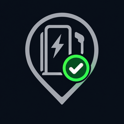
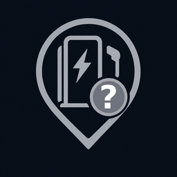

<p align="center"></p>

# EnBW Laadpalen

Home Assistant-integratie die laat zien **welke EnBW-laadpunten nu vrij zijn**. Zoek laadpalen in een zone op de kaart, voeg ze toe als eigen apparaat en laat Home Assistant ze automatisch verversen wanneer jij in de buurt komt.

- Aantal vrije laadpunten per laadpaal, plus de status per laadpunt, vermogen, connectoren en openingstijden
- Markers op de HA-kaart die in één oogopslag tonen of er plek is
- Slim verversen: alleen als iemand in de buurt is, zodat de API niet onnodig wordt aangeroepen
- Melding (gebeurtenis) zodra een laadpunt vrijkomt terwijl je in de buurt bent

## Installeren
1. HACS → menu → *Aangepaste repositories* → voeg `https://github.com/GruttePier013/EnBW-chargestations` toe (type *Integratie*).
2. Download **EnBW Laadpalen** en herstart Home Assistant.
3. Instellingen → Apparaten & services → Integratie toevoegen → **EnBW Laadpalen**.

Handmatig: kopieer `custom_components/enbw_laadpalen` naar `config/custom_components/`.

## Laadpalen toevoegen
1. **API-sleutel** (eenmalig, geldt voor alle laadpalen). EnBW biedt geen publieke registratie; gebruik de sleutel die de EnBW-laadstationkaart in de browser meestuurt (header `Ocp-Apim-Subscription-Key`). Wordt de sleutel geweigerd, dan vraagt Home Assistant automatisch om opnieuw te verifiëren.
2. **Standaardwaarden** voor nieuwe laadpalen: vernieuwingsfrequentie, zone radius, vernieuwen in zone en de bijbehorende frequentie en maximale duur. Je kunt ze later aanpassen onder *Configureren → Instellingen*.
3. **Zoeken op de kaart:** typ een plaatsnaam of adres en druk op Enter, dan springt de pin erheen. Verplaats de pin en stel de zoekradius in (50–5000 m). Of kies *Stationsnummer invoeren*.
4. **Resultaten:** vink de gewenste laadpalen aan. Elke laadpaal wordt een eigen apparaat. Per laadpaal zie je twee regels:
   ```
   Hoofdlaan 1, Amsterdam
   2/10 beschikbaar, ⚡17kW vermogen, 📍2925161, 140m van huis
   ```
   (vrije/totaal laadpunten, hoogste vermogen, locatiecode en afstand vanaf je thuislocatie)
5. **Per laadpaal:** naam, optioneel de **connectortypen** en het **minimale vermogen** dat meetelt.

Later beheer je alles via *Configureren*: laadpalen toevoegen, bewerken of verwijderen (ook via *Apparaat verwijderen*), personen kiezen, standaardwaarden, foutbeveiliging en de API-sleutel. Bij *Laadpaal bewerken* kun je de **pin van de laadpaal op de kaart verschuiven**; *EnBW-positie herstellen* zet hem terug.

## Laadpalen op de kaart
Elke laadpaal krijgt een sensor met de naam van straat en huisnummer en als status bijvoorbeeld `2/10 beschikbaar`. De sensor heeft `latitude` en `longitude` en toont een marker die meeverandert met de beschikbaarheid:

| Marker | Betekenis |
|:---:|---|
|  | 2 of meer laadpunten vrij |
|  | 1 laadpunt vrij |
|  | niets vrij of gesloten |
|  | onbekend, geen gegevens of ouder dan 1 dag |

De markers zijn uit te zetten onder *Configureren → Instellingen* (dan krijg je het gewone icoon).

## Entiteiten per laadpaal
**Beschikbaarheid**

| Entiteit | Inhoud |
|---|---|
| **Laadpunten** | `2/4 beschikbaar` of `Gesloten`; attribuut `laadpunten` met de status per laadpunt |
| **Beschikbare laadpunten** | aantal vrije laadpunten (handig voor automatiseringen en grafieken) |
| **Beschikbaarheid visueel** | één icoon per laadpunt, bijv. `🅿️/⛔`: 🅿️ vrij, ⛔ bezet of gesloten, ⚫ storing, onbekend of verouderd |
| **Beschikbaar** | binary_sensor: minstens één laadpunt vrij |
| **Laadpunt 1 - 17kW**, … | binary_sensor per laadpunt: *Bezet*, *Vrij* of *Onbekend* |
| **Laadpunt vrijgekomen** | event-entiteit, zie *Gebeurtenis* |

**Nabijheid en verversen**

| Entiteit | Inhoud |
|---|---|
| **Personen nabij**, **Zone radius** | wie er binnen de zone is, en hoe groot de zone is |
| **Vernieuwen** (knop), **Vernieuwingsfrequentie** | handmatig verversen, en een vast schema (standaard *Nooit*) |
| **Vernieuwen in zone**, **Alleen vernieuwen bij naderen**, **Vernieuwingsfrequentie in zone**, **Vernieuwen in zone stoppen na** | zie *Verversen in de zone* |
| **Alle laadpalen vernieuwen** (knop) | ververst alle laadpalen tegelijk |

**Diagnose** (standaard verborgen onder *Diagnose* op het apparaat)

*Maximaal vermogen*, *Afstand tot persoon* (meters; attributen `person`, `in_zone`, `approaching`), *Connectortypen* (standaard uit), *Gepauzeerd*, *Opeenvolgende fouten*, *Locatiecode*, *Opgehaalde laadpunten* en *Bijgewerkt*.

## Verversen in de zone
Verversen gebeurt per *bezoek*, zodat de API niet onnodig wordt aangeroepen:

1. **Afwezig:** er wordt niets ververst (de vernieuwingsfrequentie staat standaard op *Nooit*).
2. **Binnenkomst:** één verversing, daarna elke X minuten (1x, 2, 5, 10 of 15 min; standaard 5).
3. **Alleen bij naderen** (standaard aan): alleen verversen als iemand minstens 25 m dichterbij is gekomen.
4. **Stoppen na** 10, 30, 60, 120 min of onbeperkt (standaard 30 min), ook als je er nog bent.
5. **Nieuw bezoek** begint pas als de zone minstens de *afkoeltijd* leeg was (standaard 15 min). Meerdere personen delen één bezoek.

*Vernieuwen in zone* is de hoofdschakelaar: uit betekent geen verversing door aanwezigheid.

## Foutbeveiliging
- **Per laadpaal:** na een fout wacht de integratie steeds langer (tot 15 min). Na X fouten achter elkaar (standaard 5) wordt de laadpaal gepauzeerd, met een melding onder *Herstellen*.
- **Hele API:** na X fouten achter elkaar (standaard 10) of een HTTP 429 pauzeren alle automatische aanroepen tijdelijk (respecteert `Retry-After`).
- **Spreiding:** automatische aanroepen hebben minstens N seconden ertussen (standaard 3 s).
- De knop *Vernieuwen* en de actie `enbw_laadpalen.refresh` omzeilen een pauze en hervatten bij succes.

Alles is instelbaar onder *Configureren → Instellingen*.

## Actie en gebeurtenis
**Actie** `enbw_laadpalen.refresh`: ververst direct. Zonder doel (`data: {}`) alle laadpalen; met een doel (apparaten, entiteiten of gebied, te kiezen in de UI) alleen de gekozen laadpalen.

**Gebeurtenis** `enbw_laadpalen_charge_point_available`: een laadpunt gaat van bezet naar vrij terwijl iemand in de zone is. Gegevens: `station_id`, `station_name`, `charge_point`, `number`, `evse`, `power_kw`, `connectors`, `available`, `total`, `persons`.

```yaml
triggers:
  - trigger: event
    event_type: enbw_laadpalen_charge_point_available
actions:
  - action: notify.mobile_app_telefoon
    data:
      message: "{{ trigger.event.data.charge_point }} is vrij bij {{ trigger.event.data.station_name }}"
```

## Verouderde gegevens
Is de laatste succesvolle update ouder dan 1 dag (bijvoorbeeld bij vernieuwingsfrequentie *Nooit*), dan toont *Beschikbaarheid visueel* ⚫ en krijgt de kaartmarker een grijs vraagteken.

## Diagnostics
*Apparaten en diensten → EnBW Laadpalen → ⋮ → Diagnostics downloaden* bevat de configuratie (API-sleutel afgeschermd), de API-gezondheid en het ruwe EnBW-antwoord per laadpaal. Handig bij een afwijkende status of ontbrekend veld.

## Beperkingen
- De EnBW-API is niet officieel gedocumenteerd; de velden zijn afgeleid van de EnBW-charge map en kunnen veranderen.
- Statussen die op een defect duiden (bijv. `OUT_OF_SERVICE`, `INOPERATIVE`, `FAULTED`) tellen als *buiten werking*; andere onbekende statussen tellen als bezet.
