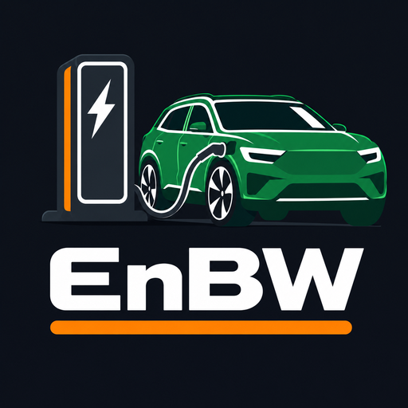

<p align="center"></p>

# EnBW Laadpalen

Home Assistant-integratie voor de actuele status van EnBW-laadpalen: beschikbare laadpunten, vermogen, connectoren en openingstijden. Zoek laadpalen in een zone op de kaart; elke laadpaal wordt een eigen apparaat, met slim verversen op basis van de nabijheid van personen.

## Installeren
1. HACS → menu → *Aangepaste repositories* → voeg `https://github.com/GruttePier013/EnBW-chargestations` toe (type *Integratie*).
2. Download **EnBW Laadpalen** en herstart Home Assistant.
3. Instellingen → Apparaten & services → Integratie toevoegen → **EnBW Laadpalen**.

Handmatig: kopieer `custom_components/enbw_laadpalen` naar `config/custom_components/`.

## Instellen
1. **API-sleutel** (eenmalig). EnBW biedt geen publieke registratie; gebruik de sleutel die de EnBW-laadstationkaart in de browser meestuurt (header `Ocp-Apim-Subscription-Key`). Bij een geweigerde sleutel start Home Assistant automatisch *opnieuw verifiëren*.
2. **Standaardwaarden**: vernieuwingsfrequentie, zone radius, vernieuwen in zone en de bijbehorende frequentie en maximale duur.
3. **Laadpalen zoeken**: typ een plaatsnaam of adres en druk op Enter, verplaats de pin en stel de zoekradius in (50–5000 m). Of kies *Stationsnummer invoeren*.
4. **Resultaten**: vink de gewenste laadpalen aan. Per laadpaal zie je adres, beschikbare/totaal laadpunten, vermogen, locatiecode, afstand en windrichting.
5. Per laadpaal: naam, optioneel **connectortypen** en **minimaal vermogen**.

Via *Configureren* voeg je laadpalen toe, bewerk of verwijder je ze en pas je de instellingen aan (personen, afkoeltijd, standaardwaarden, foutbeveiliging, API-sleutel).

## Entiteiten per laadpaal
| Entiteit | Inhoud |
|---|---|
| **Laadpunten** | `2/4 beschikbaar` of `Gesloten`; attribuut `laadpunten` met de status per laadpunt |
| **Beschikbare laadpunten** | aantal beschikbare laadpunten |
| **Beschikbaarheid visueel** | één icoon per laadpunt, bijv. `🅿️/⛔` (🅿️ beschikbaar, ⛔ bezet of gesloten, ⚫ storing, onbekend of verouderd) |
| **Beschikbaar** | binary_sensor: minstens één laadpunt beschikbaar |
| **Laadpunt 1 - 17kW**, … | binary_sensor per laadpunt: *Bezet*, *Vrij* of *Onbekend* |
| **Laadpaal op kaart** | device_tracker, genoemd naar straat en huisnummer, met de status van *Laadpunten* en een marker: groen = alles beschikbaar, gedeeltelijk, rood = niets beschikbaar, grijs vraagteken = onbekend of verouderd |
| **Personen nabij**, **Zone radius** | personen binnen de zone |
| **Vernieuwen**, **Vernieuwingsfrequentie** | knop en keuzelijst (standaard *Nooit*) |
| **Vernieuwen in zone**, **Alleen vernieuwen bij naderen**, **Vernieuwingsfrequentie in zone**, **Vernieuwen in zone stoppen na** | zie *Verversen in de zone* |
| **Laadpunt vrijgekomen** | event-entiteit |
| Diagnose | *Maximaal vermogen*, *Afstand tot persoon* (meters, met attributen `person`, `in_zone`, `approaching`), *Connectortypen* (standaard uit), *Gepauzeerd*, *Opeenvolgende fouten*, *Locatiecode*, *Opgehaalde laadpunten*, *Bijgewerkt* |

De knop **Alle laadpalen vernieuwen** (zonder apparaat) ververst alle laadpalen.

## Verversen in de zone
Verversen gebeurt per *bezoek*, zodat de API niet onnodig wordt aangeroepen:
- **Afwezig:** niets (standaard *Nooit*).
- **Binnenkomst:** één verversing, daarna elke X minuten (1x, 2, 5, 10 of 15 min; standaard 5).
- **Alleen bij naderen** (standaard aan): alleen verversen als iemand ≥ 25 m dichterbij is gekomen.
- **Stoppen na** 10, 30, 60, 120 min of onbeperkt (standaard 30 min).
- **Nieuw bezoek** pas nadat de zone minstens de *afkoeltijd* leeg was (standaard 15 min).

*Vernieuwen in zone* is de hoofdschakelaar.

## Foutbeveiliging
- **Per laadpaal:** oplopende wachttijd na een fout (tot 15 min); na X fouten achter elkaar (standaard 5) wordt de laadpaal gepauzeerd, met een melding onder *Herstellen*.
- **Hele API:** na X fouten (standaard 10) of een HTTP 429 pauzeren alle automatische aanroepen tijdelijk (respecteert `Retry-After`).
- **Spreiding:** automatische aanroepen hebben minstens N seconden ertussen (standaard 3 s).
- De knop *Vernieuwen* en de actie `enbw_laadpalen.refresh` omzeilen een pauze en hervatten bij succes.

## Acties en gebeurtenissen
**Actie** `enbw_laadpalen.refresh`: ververst direct. Zonder doel (`data: {}`) alle laadpalen; met een doel (apparaten, entiteiten of gebied, te kiezen in de UI) alleen de gekozen laadpalen.

**Gebeurtenis** `enbw_laadpalen_charge_point_available`: een laadpunt gaat van bezet naar beschikbaar terwijl iemand in de zone is. Gegevens: `station_id`, `station_name`, `charge_point`, `number`, `evse`, `power_kw`, `connectors`, `available`, `total`, `persons`.

```yaml
triggers:
  - trigger: event
    event_type: enbw_laadpalen_charge_point_available
actions:
  - action: notify.mobile_app_telefoon
    data:
      message: "{{ trigger.event.data.charge_point }} is vrij bij {{ trigger.event.data.station_name }}"
```

## Verouderde gegevens
Is de laatste succesvolle update ouder dan 1 dag, dan toont *Beschikbaarheid visueel* ⚫ en krijgt de kaartmarker een grijs vraagteken.

## Diagnostics
*Apparaten en diensten → EnBW Laadpalen → ⋮ → Diagnostics downloaden* bevat de configuratie (API-sleutel afgeschermd), de API-gezondheid en het ruwe EnBW-antwoord per laadpaal.

## Beperkingen
- De API is niet officieel gedocumenteerd; velden zijn afgeleid van de EnBW-kaart. Statussen die duiden op een defect (bijv. `OUT_OF_SERVICE`, `INOPERATIVE`, `FAULTED`) tellen als buiten werking, andere onbekende statussen als bezet.
- Gebruik de API terughoudend; verversen staat standaard op *Nooit*.

## Ontwikkelen
```
pip install -r requirements_test.txt
ruff check .
pytest
```
